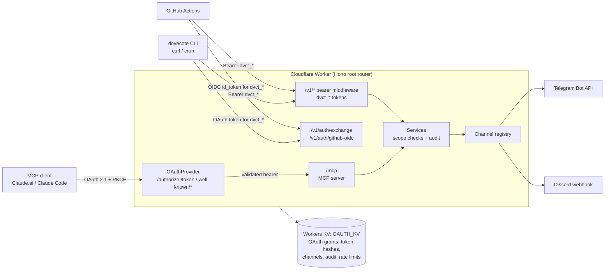

# Dovecote

[](https://github.com/musingfox/dovecote/actions/workflows/ci.yml)

[繁體中文](./README.zh-tw.md)

Dovecote is a self-hosted notification gateway on Cloudflare Workers that lets AI agents, scripts and CI jobs send messages to Telegram and Discord through one authenticated endpoint, exposed both as an MCP server and as a REST API.

## The problem

Long-running agents (a Claude Code session, a Claude.ai conversation, a CI pipeline, a cron job) need a way to tell a person "done" or "failed". Most of those callers cannot speak MCP, and headless ones cannot click through an interactive OAuth flow. Giving each of them its own bot token or webhook URL spreads channel credentials across every machine and workflow. Dovecote keeps the channel credentials in one place and gives every caller a scoped, revocable token, obtained through whichever identity flow fits that caller.

## Features

- **MCP server** at `/mcp` over stateless Streamable HTTP, with two tools: `send_notification` and `list_channels`. It works as a Claude.ai custom connector and from Claude Code.
- **OAuth 2.1 authorization server**, built on [`@cloudflare/workers-oauth-provider`](https://github.com/cloudflare/workers-oauth-provider): PKCE required on every authorization code flow and S256-only, RFC 8414 authorization server metadata and RFC 9728 protected resource metadata for MCP client discovery, and no dynamic client registration.
- **Passwordless sign-in.** The `/authorize` page accepts a pasted `dvct_*` API token, so no user password exists anywhere in the system.
- **Three identity paths, one auth context.** MCP clients use OAuth access tokens; the CLI trades its OAuth token for an API token at `/v1/auth/exchange`; GitHub Actions trades its OIDC `id_token` at `/v1/auth/github-oidc` (signature, audience, expiry and repository owner are verified, and the token is capped at 15 minutes).
- **REST API** under `/v1/*` for callers without MCP. `openapi.json` is generated from the zod contracts, and CI fails when it drifts.
- **Companion CLI and GitHub Action.** The `dovecote` CLI logs in with OAuth + PKCE on a loopback redirect and ships as standalone binaries for Linux, macOS and Windows. The `setup-dovecote` action installs it in a workflow and checks it against `SHA256SUMS`.

## Architecture



The HTTP API is the trunk and MCP is one adapter on top of it. Both auth paths produce the same `AuthCtx`, so the service layer does not know which protocol called it. The reasoning is in [ADR 0001](./docs/decisions/0001-http-api-trunk-and-dual-auth.md).

**Stack:** TypeScript on Cloudflare Workers, Hono, `@modelcontextprotocol/sdk`, `@cloudflare/workers-oauth-provider`, `jose` (OIDC JWT verification), zod with `zod-to-openapi`, Workers KV, Bun (tests and CLI binaries), Wrangler.

## Quick start

You need [Bun](https://bun.sh) and a Cloudflare account. Wrangler is installed as a dev dependency.

```bash
git clone https://github.com/musingfox/dovecote.git
cd dovecote
bun install
bunx wrangler login
bunx wrangler kv namespace create OAUTH_KV
```

Copy the namespace id that Wrangler prints into `wrangler.toml`, replacing the `id` in both the top-level `[[kv_namespaces]]` block and the `[[env.production.kv_namespaces]]` block. The ids committed in the repo belong to the maintainer's account. Then run the setup wizard:

```bash
bun run setup -- --env production
```

The wizard generates and pushes the `HMAC_PEPPER` and `ADMIN_REVOKE_TOKEN` secrets, prompts you to add a Telegram or Discord channel, deploys the worker, seeds your first user, mints a CLI token into `~/.config/dovecote/config.json`, and runs `bun run verify`. Without `--env` it targets staging. Generated secrets are also written to `~/.dovecote/secrets-<env>.txt` (mode 0600); move them to a password manager and delete the file.

To connect Claude.ai, add a custom connector with only the MCP endpoint URL **including the `/mcp` suffix**, for example `https://dovecote.example.com/mcp`, and leave the OAuth client ID empty: Claude.ai identifies itself with its published client metadata document (verified on staging on 2026-11-04). The bare base URL fails OAuth discovery with "Authorization with the MCP server failed." Claude then redirects to `/authorize`, where you paste a `dvct_*` token. The connector stays bound to that token: once it is revoked or expires, `/mcp` refuses the connector within about a minute (Workers KV propagation), and its refresh fails with `invalid_grant`, so Claude asks you to sign in again. If the connector cannot sign in that way, provision an OAuth client by following [docs/client-bootstrap.md](./docs/client-bootstrap.md) and enter its client ID; the wizard does not create one. Claude Code's metadata document is also accepted, but Claude Code signing in with it has not been verified yet.

An MCP client that cannot run OAuth, such as Claude Code with a fixed header, a cloud environment that injects headers, or a script, sends the `dvct_*` token itself as the bearer:

```bash
claude mcp add --transport http dovecote https://dovecote.example.com/mcp --header "Authorization: Bearer dvct_…"
```

The token needs the `dovecote:notify` scope. Revoking or letting it expire cuts the client off within about a minute (Workers KV propagation).

To send from a shell, install the CLI (see [CLI](#cli)) and run:

```bash
dovecote ping
dovecote notify telegram-ops --text "hello from dovecote"
```

Channel ids have the form `<service>-<id>`. The wizard's default instance id is `ops`, so a Telegram channel created with the defaults is `telegram-ops`.

## MCP tools

| Tool | Description |
|------|-------------|
| `send_notification` | Send a message (`text`, `embed`, `attachment`, or a combination) to a channel |
| `list_channels` | List the configured notification channels |

Both tools require the `dovecote:notify` scope.

## HTTP API

| Endpoint | Auth | Purpose |
|----------|------|---------|
| `GET /health` | none | Liveness and minimum supported CLI version |
| `POST /v1/notify` | `dvct_*` | Send a notification |
| `GET /v1/channels` | `dvct_*` | List channels |
| `GET /v1/auth/whoami` | `dvct_*` | Show the caller's identity and scopes |
| `GET` / `POST /v1/tokens` | `dvct_*` | List or mint API tokens |
| `POST /v1/tokens/:tokenId/renew` | `dvct_*` | Renew a token |
| `DELETE /v1/tokens/:tokenId` | `dvct_*` | Revoke a token |
| `POST /v1/auth/exchange` | OAuth bearer | Trade an OAuth access token for a `dvct_*` token |
| `POST /v1/auth/github-oidc` | GitHub OIDC `id_token` | Trade a GitHub Actions identity for a short-lived `dvct_*` token |

[`openapi.json`](./openapi.json) holds the schema for every endpoint above and is regenerated with `bun run openapi:gen`. The GitHub OIDC endpoint returns 503 until the worker has `GITHUB_OIDC_EXPECTED_AUD` and `GITHUB_OIDC_ALLOWED_OWNER` set.

## CLI

The CLI is released as standalone binaries for linux-x64, linux-arm64, darwin-x64, darwin-arm64 and windows-x64. Releases are tagged `cli-v<semver>` on [GitHub Releases](https://github.com/musingfox/dovecote/releases) with a `SHA256SUMS` file. The binaries are not code-signed yet; see [ADR 0003](./docs/decisions/0003-cli-binary-distribution.md) and [ADR 0004](./docs/decisions/0004-cli-binary-signing-direction.md).

### Local install

Download the archive for your platform, verify it against `SHA256SUMS`, extract it, and put `dovecote` on your `PATH`. If `bun run setup` already wrote `~/.config/dovecote/config.json`, the CLI is ready. Otherwise log in through the browser OAuth flow:

```bash
export DOVECOTE_CLIENT_ID=<id from POST /admin/bootstrap-client>
dovecote auth login --server-url https://dovecote.example.com
dovecote ping
dovecote notify telegram-ops --text "hello from cli"
```

The browser flow ends at `/v1/auth/exchange`, which requires the `dovecote:admin` scope. With a notify-only token, or on a headless machine, use `dovecote auth login --token`, which reads a `dvct_*` token from stdin. The token is stored in `$XDG_CONFIG_HOME/dovecote/config.json` (mode 0600), and the CLI renews it automatically when fewer than 14 days remain. Run `dovecote --help` for the full command list (`auth`, `notify`, `channels`, `tokens`, `ping`).

### GitHub Actions

```yaml
- uses: musingfox/dovecote/.github/actions/setup-dovecote@cli-v0.1.0
  with:
    version: "0.1.0"
    server-url: https://dovecote.example.com
    token: ${{ secrets.DOVECOTE_TOKEN }}

- run: dovecote notify telegram-ops --text "deploy complete"
```

The action exports `token` and `server-url` as `DOVECOTE_TOKEN` and `DOVECOTE_SERVER_URL` for the later steps of the job. For token provisioning, supported runners and troubleshooting, see [docs/setup-dovecote-runbook.md](./docs/setup-dovecote-runbook.md).

### Use from another Claude Code session

Once a token is in `~/.config/dovecote/config.json`, other Claude Code sessions can shell out to the CLI. Install the bundled skill so the agent finds it:

```bash
mkdir -p ~/.claude/skills
cp -R .claude/skills/dovecote-notify ~/.claude/skills/
```

The skill ([.claude/skills/dovecote-notify/SKILL.md](./.claude/skills/dovecote-notify/SKILL.md)) triggers on requests such as "notify me", "send to Telegram" or "alert me when X finishes", and runs `dovecote notify`.

## Manual deployment

The wizard covers a first deployment. To run the steps yourself:

1. **Log in** with `bunx wrangler login`, and create the KV namespace as in [Quick start](#quick-start).
2. **Set secrets** with `bun run deploy:secrets`. It prompts for `HMAC_PEPPER`, sets `ADMIN_REVOKE_TOKEN` if it is in your environment, and reads defaults from `.dev.vars`. For staging, run `WRANGLER_ENV=staging bun run deploy:secrets`. Channels are not secrets: each one is a `channel:<service>-<id>` record in `OAUTH_KV`. Add one with `bun run channel:add -- --env production`, or import a saved JSON object keyed by `telegram` and `discord` with `bun run channel:migrate -- --env production --file backup.json`.
3. **Deploy the worker** with `bun run deploy`. Production has no `workers.dev` URL: `wrangler.toml` sets `workers_dev = false` because OAuth tokens are bound to the hostname they were issued on, and one hostname keeps one sign-in per client. Attach a custom domain to the `dovecote` Worker in the Cloudflare dashboard, or set `workers_dev = true` if you want the `workers.dev` URL instead. Staging keeps its `workers.dev` URL.
4. **Verify** with `TEST_BASE_URL=https://dovecote.example.com bun run deploy:verify`. The smoke tests check OAuth metadata, that `/register` does not exist, and endpoint availability.

Upgrading a deployment whose channels still live in worker secrets? Follow [Channel Cutover](./docs/deploy-runbook.md#channel-cutover-worker-secrets-to-kv-records) in order: migrating after you deploy, or deleting the old secrets first, drops every channel. Client provisioning and operations are covered in [docs/deploy-runbook.md](./docs/deploy-runbook.md) and [docs/client-bootstrap.md](./docs/client-bootstrap.md).

## Development

```bash
bun install
cp .dev.vars.example .dev.vars   # then set HMAC_PEPPER
bun run dev                      # wrangler dev
bun test                         # unit tests
bun run typecheck
```

Channels are not read from `.dev.vars`; the worker resolves them from `channel:<service>-<id>` records in `OAUTH_KV`.

`bun test` skips the E2E, integration and CLI suites (see `bunfig.toml`). Run them explicitly:

```bash
bun run test:e2e
(cd cli && bun test)
bun run test:integration:build && bun run test:integration
TEST_BASE_URL=https://dovecote.example.com bun run test:e2e:remote
```

Without `TEST_BASE_URL`, the E2E tests run in-process through `app.fetch()`. With it, they send real HTTP requests and skip the cases that need a custom in-process environment. To also assert which channels a deployment exposes, add `TEST_EXPECTED_CHANNELS='telegram-default,discord-ops'`.

## Security

- **OAuth 2.1 + PKCE:** `/authorize` rejects any request without an S256 `code_challenge` with `400 invalid_request`, so no authorization code is issued without PKCE; plain challenges are rejected.
- **No dynamic client registration:** there is no `/register` endpoint, and the authorization server metadata advertises none. A URL client ID is accepted only for the two Claude client metadata documents, Claude.ai's and Claude Code's, and any other URL client ID is refused before it is fetched. The operator provisions other clients through `/admin/bootstrap-client`, which stays off unless `ENABLE_CLIENT_BOOTSTRAP=1`.
- **Token-paste authorization:** `/authorize` accepts only a POSTed `dvct_*` token. The token itself is the anti-forgery secret, since no ambient cookie credential exists, and submissions are rate-limited per IP.
- **Hashed API tokens:** `dvct_*` tokens are stored as HMAC-SHA256 hashes keyed by `HMAC_PEPPER`, with a maximum TTL of 90 days.
- **Rate limiting:** admin endpoints allow 5 requests per 60 seconds per IP. The token, notify, OIDC and authorize endpoints have their own per-IP limits.
- **Audit trail:** authorization, privileged operations and every send are logged to KV with a 90-day TTL, and as console lines that Workers Logs (enabled in every environment) can query. Each send writes a `notify.send` record naming the `dvct_*` token's id and label.
- **Anti-clickjacking headers:** `/authorize` sends `Content-Security-Policy: frame-ancestors 'none'` and `X-Frame-Options: DENY`.
- **Scopes:** `dovecote:notify` sends notifications. `dovecote:admin` is required to mint or revoke tokens, to list or renew other users' tokens, and to exchange an OAuth token at `/v1/auth/exchange`.

### Vulnerability reporting

Please report security vulnerabilities privately via [GitHub Security Advisories](https://github.com/musingfox/dovecote/security/advisories/new). Do not file public issues for security problems.

## License

MIT
