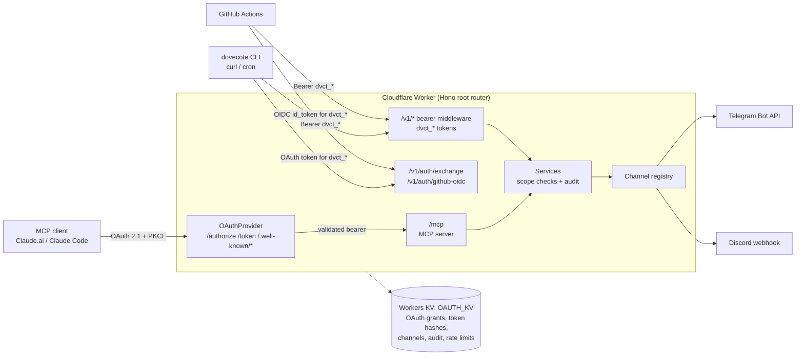

# Dovecote

[](https://github.com/musingfox/dovecote/actions/workflows/ci.yml)

[English](./README.md)

Dovecote 是部署在 Cloudflare Workers 上、可自行架設的通知閘道。AI agent、script 與 CI job 透過同一個需要認證的端點把訊息送到 Telegram 與 Discord，這個端點同時以 MCP server 與 REST API 兩種形式提供。

## 要解決的問題

長時間執行的 agent（Claude Code session、Claude.ai 對話、CI pipeline、cron job）需要一個方法告訴人「做完了」或「失敗了」。這些呼叫端大多不會說 MCP，headless 的呼叫端也沒辦法點完互動式的 OAuth 流程。如果每個呼叫端都各自拿一份 bot token 或 webhook URL，頻道憑證就會散落在每台機器與每個 workflow 裡。Dovecote 把頻道憑證集中在一處，並讓每個呼叫端透過適合它的身分流程，取得一把有 scope、可撤銷的 token。

## 特色

- **MCP server**：位於 `/mcp`，走 stateless Streamable HTTP，提供 `send_notification` 與 `list_channels` 兩個 tool。可以當 Claude.ai 的 custom connector，也可以從 Claude Code 使用。
- **OAuth 2.1 授權伺服器**：建構在 [`@cloudflare/workers-oauth-provider`](https://github.com/cloudflare/workers-oauth-provider) 之上。每個 authorization code flow 都必須用 PKCE，且只接受 S256，提供 RFC 8414 授權伺服器 metadata 與 RFC 9728 protected resource metadata 供 MCP client discovery，並且不開放動態客戶端註冊。
- **無密碼登入**：`/authorize` 頁面接受貼上的 `dvct_*` API token，整個系統裡不存在使用者密碼。
- **三條身分路徑，一個認證 context**：MCP client 使用 OAuth access token；CLI 在 `/v1/auth/exchange` 把 OAuth token 換成 API token；GitHub Actions 在 `/v1/auth/github-oidc` 用 OIDC `id_token` 換 token（會驗證簽章、audience、到期時間與 repository owner，token 上限 15 分鐘）。
- **REST API**：`/v1/*` 給不支援 MCP 的呼叫端使用。`openapi.json` 由 zod contract 產生，與程式碼不一致時 CI 會失敗。
- **配套的 CLI 與 GitHub Action**：`dovecote` CLI 透過 loopback redirect 走 OAuth + PKCE 登入，並以 Linux、macOS、Windows 的獨立執行檔發布。`setup-dovecote` action 在 workflow 裡安裝 CLI，並用 `SHA256SUMS` 驗證。

## 架構



HTTP API 是主幹，MCP 是架在上面的一個 adapter。兩條認證路徑都產出同一個 `AuthCtx`，所以 service layer 不知道是哪一種協定呼叫它。決策理由見 [ADR 0001](./docs/decisions/0001-http-api-trunk-and-dual-auth.md)。

**技術棧**：Cloudflare Workers 上的 TypeScript、Hono、`@modelcontextprotocol/sdk`、`@cloudflare/workers-oauth-provider`、`jose`（驗證 OIDC JWT）、zod 搭配 `zod-to-openapi`、Workers KV、Bun（測試與 CLI 執行檔）、Wrangler。

## 快速開始

需要 [Bun](https://bun.sh) 與一個 Cloudflare 帳號。Wrangler 會以 dev dependency 安裝。

```bash
git clone https://github.com/musingfox/dovecote.git
cd dovecote
bun install
bunx wrangler login
bunx wrangler kv namespace create OAUTH_KV
```

把 Wrangler 印出的 namespace id 寫進 `wrangler.toml`，取代最上層 `[[kv_namespaces]]` 與 `[[env.production.kv_namespaces]]` 兩個區塊裡的 `id`。repo 裡提交的 id 屬於 maintainer 的帳號。接著執行設定精靈：

```bash
bun run setup -- --env production
```

精靈會產生並推送 `HMAC_PEPPER` 與 `ADMIN_REVOKE_TOKEN` 兩個 secret、提示你新增 Telegram 或 Discord 頻道、部署 worker、建立第一個使用者、把 CLI token 寫入 `~/.config/dovecote/config.json`，最後執行 `bun run verify`。不帶 `--env` 時目標是 staging。產生的 secret 也會寫到 `~/.dovecote/secrets-<env>.txt`（mode 0600），請移到密碼管理器後刪除該檔案。

要接上 Claude.ai，先照 [docs/client-bootstrap.md](./docs/client-bootstrap.md) 為它配置一個 OAuth client，精靈不會建立 client。接著新增 custom connector，填入該 client id 與 MCP 端點 URL，**務必包含 `/mcp` 後綴**，例如 `https://dovecote.example.com/mcp`。只填 base URL 會讓 OAuth discovery 失敗，畫面顯示「Authorization with the MCP server failed.」。之後 Claude 會跳轉到 `/authorize`，在那裡貼上 `dvct_*` token。

無法走 OAuth 的 MCP client，例如用固定 header 的 Claude Code、會注入 header 的雲端環境或腳本，可以直接把 `dvct_*` token 當成 bearer 送出：

```bash
claude mcp add --transport http dovecote https://dovecote.example.com/mcp --header "Authorization: Bearer dvct_…"
```

這個 token 需要 `dovecote:notify` scope。token 一旦撤銷或過期，client 的下一個請求就會被拒絕。

要從 shell 發送，先安裝 CLI（見 [CLI](#cli)），再執行：

```bash
dovecote ping
dovecote notify telegram-ops --text "hello from dovecote"
```

頻道 id 的格式是 `<service>-<id>`。精靈預設的 instance id 是 `ops`，所以用預設值建立的 Telegram 頻道是 `telegram-ops`。

## MCP tools

| Tool | 說明 |
|------|------|
| `send_notification` | 發送訊息（`text`、`embed` 或兩者）到指定頻道 |
| `list_channels` | 列出已設定的通知頻道 |

兩個 tool 都需要 `dovecote:notify` scope。

## HTTP API

| 端點 | 認證 | 用途 |
|------|------|------|
| `GET /health` | 無 | 存活檢查與最低支援的 CLI 版本 |
| `POST /v1/notify` | `dvct_*` | 發送通知 |
| `GET /v1/channels` | `dvct_*` | 列出頻道 |
| `GET /v1/auth/whoami` | `dvct_*` | 顯示呼叫者的身分與 scope |
| `GET` / `POST /v1/tokens` | `dvct_*` | 列出或簽發 API token |
| `POST /v1/tokens/:tokenId/renew` | `dvct_*` | 續期 token |
| `DELETE /v1/tokens/:tokenId` | `dvct_*` | 撤銷 token |
| `POST /v1/auth/exchange` | OAuth bearer | 用 OAuth access token 換 `dvct_*` token |
| `POST /v1/auth/github-oidc` | GitHub OIDC `id_token` | 用 GitHub Actions 身分換短效的 `dvct_*` token |

[`openapi.json`](./openapi.json) 收錄上表所有端點的 schema，用 `bun run openapi:gen` 重新產生。worker 設好 `GITHUB_OIDC_EXPECTED_AUD` 與 `GITHUB_OIDC_ALLOWED_OWNER` 之前，GitHub OIDC 端點會回 503。

## CLI

CLI 以 linux-x64、linux-arm64、darwin-x64、darwin-arm64、windows-x64 的獨立執行檔發布。release 在 [GitHub Releases](https://github.com/musingfox/dovecote/releases) 以 `cli-v<semver>` 標記，並附 `SHA256SUMS` 檔。執行檔目前還沒有程式碼簽章，見 [ADR 0003](./docs/decisions/0003-cli-binary-distribution.md) 與 [ADR 0004](./docs/decisions/0004-cli-binary-signing-direction.md)。

### 本機安裝

下載對應平台的壓縮檔，用 `SHA256SUMS` 驗證後解壓，把 `dovecote` 放進 `PATH`。如果 `bun run setup` 已經寫好 `~/.config/dovecote/config.json`，CLI 就能直接使用；否則透過瀏覽器 OAuth 流程登入：

```bash
export DOVECOTE_CLIENT_ID=<id from POST /admin/bootstrap-client>
dovecote auth login --server-url https://dovecote.example.com
dovecote ping
dovecote notify telegram-ops --text "hello from cli"
```

瀏覽器流程最後會呼叫 `/v1/auth/exchange`，這一步需要 `dovecote:admin` scope。如果手上只有 notify scope 的 token，或是在 headless 機器上，請改用 `dovecote auth login --token`，它會從 stdin 讀取 `dvct_*` token。token 存在 `$XDG_CONFIG_HOME/dovecote/config.json`（mode 0600），剩餘效期少於 14 天時 CLI 會自動續期。完整指令清單（`auth`、`notify`、`channels`、`tokens`、`ping`）請執行 `dovecote --help`。

### GitHub Actions

```yaml
- uses: musingfox/dovecote/.github/actions/setup-dovecote@cli-v0.1.0
  with:
    version: "0.1.0"
    server-url: https://dovecote.example.com
    token: ${{ secrets.DOVECOTE_TOKEN }}

- run: dovecote notify telegram-ops --text "deploy complete"
```

action 會把 `token` 與 `server-url` 匯出成 `DOVECOTE_TOKEN` 與 `DOVECOTE_SERVER_URL`，供同一個 job 後續的步驟使用。token 配置、支援的 runner 與疑難排解，見 [docs/setup-dovecote-runbook.md](./docs/setup-dovecote-runbook.md)。

### 從其他 Claude Code session 使用

`~/.config/dovecote/config.json` 有 token 之後，其他 Claude Code session 就能呼叫 CLI。安裝隨附的 skill，讓 agent 找得到它：

```bash
mkdir -p ~/.claude/skills
cp -R .claude/skills/dovecote-notify ~/.claude/skills/
```

這個 skill（[.claude/skills/dovecote-notify/SKILL.md](./.claude/skills/dovecote-notify/SKILL.md)）會在「notify me」、「send to Telegram」、「alert me when X finishes」這類請求時觸發，並執行 `dovecote notify`。

## 手動部署

第一次部署用精靈就夠了。若要自己逐步執行：

1. **登入**：執行 `bunx wrangler login`，並照[快速開始](#快速開始)建立 KV namespace。
2. **設定 secret**：執行 `bun run deploy:secrets`。script 會提示輸入 `HMAC_PEPPER`，環境裡有 `ADMIN_REVOKE_TOKEN` 時一併設定，並以 `.dev.vars` 的值作為預設。staging 環境請執行 `WRANGLER_ENV=staging bun run deploy:secrets`。頻道不是 secret，每個頻道是 `OAUTH_KV` 裡的一筆 `channel:<service>-<id>` 記錄。用 `bun run channel:add -- --env production` 新增，或用 `bun run channel:migrate -- --env production --file backup.json` 匯入以 `telegram` 與 `discord` 為 key 的 JSON 物件。
3. **部署 worker**：執行 `bun run deploy`。production 沒有 `workers.dev` 網址，因為 `wrangler.toml` 設了 `workers_dev = false`：OAuth token 綁定簽發時的網域，只留一個網域，每個 client 就只需要登入一次。請在 Cloudflare dashboard 替 `dovecote` Worker 綁定自訂網域；若想改用 `workers.dev` 網址，就把它設成 `workers_dev = true`。staging 仍保留 `workers.dev` 網址。
4. **驗證**：執行 `TEST_BASE_URL=https://dovecote.example.com bun run deploy:verify`。smoke tests 會檢查 OAuth metadata、`/register` 是否不存在，以及端點可用性。

若是升級既有部署、頻道還放在 worker secret 裡，請照 [Channel Cutover](./docs/deploy-runbook.md#channel-cutover-worker-secrets-to-kv-records) 的順序做：先部署再 migrate，或先刪舊 secret，都會讓所有頻道消失。客戶端配置與維運細節見 [docs/deploy-runbook.md](./docs/deploy-runbook.md) 與 [docs/client-bootstrap.md](./docs/client-bootstrap.md)。

## 開發

```bash
bun install
cp .dev.vars.example .dev.vars   # then set HMAC_PEPPER
bun run dev                      # wrangler dev
bun test                         # unit tests
bun run typecheck
```

頻道不從 `.dev.vars` 讀取，worker 會從 `OAUTH_KV` 的 `channel:<service>-<id>` 記錄解析。

`bun test` 會跳過 E2E、integration 與 CLI 測試（見 `bunfig.toml`），需要另外執行：

```bash
bun run test:e2e
(cd cli && bun test)
bun run test:integration:build && bun run test:integration
TEST_BASE_URL=https://dovecote.example.com bun run test:e2e:remote
```

沒有設定 `TEST_BASE_URL` 時，E2E 測試透過 `app.fetch()` 在 process 內執行。設定之後會發出真正的 HTTP 請求，並跳過需要客製 in-process 環境的案例。若要一併斷言部署暴露哪些頻道，加上 `TEST_EXPECTED_CHANNELS='telegram-default,discord-ops'`。

## 安全性

- **OAuth 2.1 + PKCE**：`/authorize` 對沒有 S256 `code_challenge` 的請求一律回 `400 invalid_request`，所以沒有 PKCE 就拿不到 authorization code；plain 會被拒絕。
- **不開放動態客戶端註冊**：沒有 `/register` 端點，授權伺服器 metadata 也不宣稱有。operator 透過 `/admin/bootstrap-client` 配置客戶端，這個端點在 `ENABLE_CLIENT_BOOTSTRAP=1` 之前保持關閉。
- **貼 token 授權**：`/authorize` 只接受 POST 的 `dvct_*` token。因為不存在 cookie 這類環境憑證，token 本身就是防偽 secret，提交次數也依 IP 限制。
- **雜湊儲存的 API token**：`dvct_*` token 以 `HMAC_PEPPER` 為金鑰做 HMAC-SHA256 雜湊後儲存，效期上限 90 天。
- **速率限制**：admin 端點每個 IP 每 60 秒限 5 次。token、notify、OIDC 與 authorize 端點各有自己的每 IP 限制。
- **稽核軌跡**：授權與特權操作記錄到 KV，保留 90 天。
- **防點擊劫持標頭**：`/authorize` 回傳 `Content-Security-Policy: frame-ancestors 'none'` 與 `X-Frame-Options: DENY`。
- **Scope**：`dovecote:notify` 用來發送通知。簽發 token、管理其他使用者的 token，以及在 `/v1/auth/exchange` 交換 OAuth token，都需要 `dovecote:admin`。

### 漏洞通報

請透過 [GitHub Security Advisories](https://github.com/musingfox/dovecote/security/advisories/new) 私下回報安全漏洞，請勿開立公開 issue 討論安全問題。

## License

MIT
